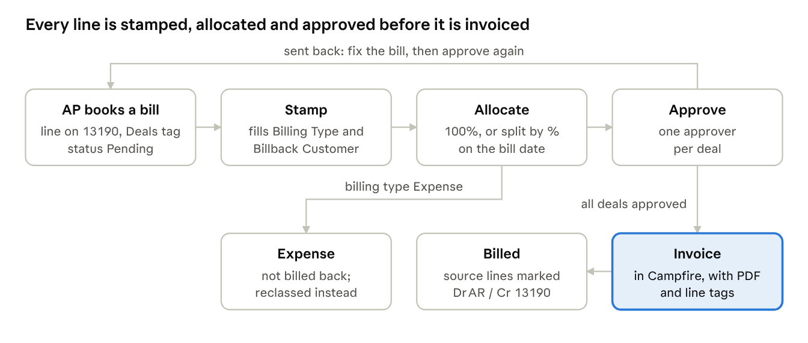

# Rekindle Implementation Guide

November 14, 2026 · David Silver

## Overview

Rekindle bills reimbursable deal expenses back to the funds and portfolio companies that owe them, inside Campfire. A firm books deal costs (legal, diligence, travel) to **13190 Unbilled Receivable**; Rekindle works out who owes each line, gets each deal signed off, then creates the invoices in Campfire with a branded PDF and marks the source bills Billed.

This guide is for the **Campfire implementer** setting Rekindle up for a new private equity or real estate customer. Work through Steps 1 to 4 in order; budget about half a day plus the customer's time to confirm deal ownership. The user guide and troubleshooting sections are written so you can hand them to the customer's finance team after go-live.

| You'll need | Why |
| --- | --- |
| Admin access to the customer's Campfire workspace | Tags, custom field, product, webhook, OAuth app |
| A Render account (or the firm's hosting) | Rekindle runs there with a Postgres database |
| The Rekindle GitHub repo | Render deploys from it |
| The customer's deal list and who owns each deal | Drives billing type and allocations |
| A Google Workspace admin (optional) | Google sign-in for users |

## How it works

Every reimbursable expense moves through four stages, and its **Billback Status** tag in Campfire shows where it is: Pending, then Allocated Pending Invoice for a split line part-way invoiced, then Billed.

A deal sent back goes to AP to fix the bill, then returns for approval; Expense lines leave the flow at allocation.

1. **Stamp.** A bill line on 13190 with status Pending is read from its **Deals** tag. Rekindle fills a blank **Billing Type** and adds the **Billback Customer** tag from the deal's setup. Anything AP set by hand is left as entered. Stamping runs on every bill save (webhook) or from the Billback Queue.
2. **Allocate.** Deal and Fund lines go 100% to one billback customer. Allocation lines split across the deal's owners by their percentages on the bill date. Amounts are worked in cents and any leftover cent goes to the largest share, so a split always adds back to the line. Expense lines are not billed back.
3. **Approve.** Each deal has one approver, who approves or sends back that deal's lines. If a line or amount changes after approval, the deal shows Changed since approval and needs approving again.
4. **Invoice.** Once every deal feeding a billback customer is approved, an admin creates its invoice. Rekindle creates the invoice in Campfire, attaches the PDF, copies department and tags onto each invoice line, and marks the source lines Billed.

| Billing type | Who is invoiced | Typical use |
| --- | --- | --- |
| Deal | The deal's own billback customer, 100% | A portfolio company reimbursing its deal costs |
| Fund | One fund, 100% | Deals in diligence charged to the fund |
| Allocation | Several owners by %, effective-dated | Co-invest vehicles sharing a deal |
| Expense | No one | Firm cost: marked To be expensed, then moved off 13190 by a reclass journal entry |

**What posts where.** Each invoice uses the Reimbursable Item product, whose income account is 13190. The invoice posts Dr Accounts Receivable / Cr 13190 Unbilled Receivable, clearing the unbilled balance the bills built up. Expense lines are cleared by a **reclass** journal entry instead: Dr the Recharge Category's expense account / Cr 13190, one pair per line with its deal, department and tags, posted from the Reclass screen in a reviewed batch on a date you choose; the lines then show Expensed.

**What Rekindle never does.** It never changes amounts, accounts or a Billing Type someone set, never bills a share twice (each line share is reserved in its database before an invoice is created), and writes nothing to Campfire until writing is switched on.

## Before you start

Collect these from the customer before touching Campfire; the deal list is what most often holds up go-live.

| Collect | Example | Used for |
| --- | --- | --- |
| The unbilled receivable account | 13190 Unbilled Receivable | Which bill lines Rekindle reads |
| Every active deal and its billing type | Deal XYZ: Deal; Fund II: Allocation | Deal setup |
| Who each deal bills | Deal XYZ bills Deal XYZ (the portfolio company) | Billback Customer tags |
| Owners and % for allocation deals, with start dates | Fund II: Main 80%, Co-Invest 15%, Employees Only 5% | Allocations |
| An approver per deal | the deal team lead's email | Approvals |
| Recharge categories | Legal, Travel, Diligence | Invoice grouping and the PDF |
| Invoice branding | from name, address, remit-to, terms, footer | The PDF |
| Who uses Rekindle, and who are admins | finance team emails | Sign-in and permissions |

Also confirm two decisions with the controller:

- [ ] Invoices post on creation (Accounting: Invoices = Write), not as drafts
- [ ] Rekindle may fill blank Billing Types and add Billback Customer tags on Pending lines automatically

## Step 1 — Configure Campfire

Set up the account, tags, field and product Rekindle reads, then note each one's ID for Step 2.

1. **Account.** Confirm the unbilled receivable account exists (number 13190 by default). Reimbursable bill lines must be coded to it.
2. **Tag groups.** Create these tag groups (Settings → Tags), or reuse the customer's own names:

   | Tag group | Tags | Notes |
   | --- | --- | --- |
   | Deals | one per deal | AP puts this on every reimbursable bill line |
   | Billback Customer | one per party invoiced | Link each tag to its Campfire customer, or Rekindle can't invoice it |
   | Billback Status | Pending, Bill Back, Allocated, Allocated Pending Invoice, Billed, Historical, To be expensed, Expensed, Reserved, Transferred | Rekindle reads Pending and Allocated Pending Invoice, and writes Billed |
   | Recharge Category | Legal, Travel, Diligence, ... | Groups lines on the PDF |
   | Class (optional) | the customer's classes | Copied onto invoice lines |
3. **Custom field.** Add a bill-line custom field **Default Billing Type** (`custom_field_defaultbillingtype`) with options Deal, Fund, Allocation, Expense. AP can set it by hand; Rekindle fills it when blank.
4. **Product.** Create **Reimbursable Item** (Products and Services). Set **Invoice Credit Account** = 13190 Unbilled Receivable, and untick **Recognize Revenue** and **MRR item**. Note its number (for example 699767), not its long ID.
5. **Expense accounts.** Decide which expense account each Recharge Category's unbilled costs move to when a deal cost isn't billed back (for example Legal → 6100 Legal expense). You'll set these in Rekindle on Settings → Reclass accounts, where **Fill by name** sets every unset category to the expense account tagged with it or named the same (review them after).
6. **AP process.** Make sure AP codes reimbursable lines to 13190 with a Deals tag, a Recharge Category, and Billback Status = Pending.

Update `config/rekindle.json` in the repo with the customer's tag group IDs, Billback Status tag IDs, account number and invoice branding. To find the IDs, ask Claude to read them through the Campfire connector.

## Step 2 — Deploy Rekindle on Render

Render runs Rekindle from the GitHub repo; the `render.yaml` blueprint sets up the web service, and a Render Postgres database keeps approvals, deal setup and the record of what has been invoiced.

1. **Service.** Render → **New → Blueprint** → pick the Rekindle repo. Render creates the web service and generates `REKINDLE_ADMIN_TOKEN` and `SESSION_SECRET`.
2. **Database.** Render → **New → Postgres**, in the **same region** as the service. Copy its **Internal Database URL** into the service's `DATABASE_URL`. Tables are created on start. Invoices can't be created without it.
3. **Settings.** In the service's **Environment** tab, set:

   | Variable | Set to |
   | --- | --- |
   | `REKINDLE_INVOICE_PRODUCT_ID` | the Reimbursable Item product's number |
   | `REKINDLE_ADMINS` | admin emails, comma-separated |
   | `REKINDLE_ALLOWED_DOMAIN` | the firm's email domain |
   | `REKINDLE_WRITE` | leave unset (off) until Step 4 |
   | `CAMPFIRE_API_KEY` | optional fallback; see Step 3 |
4. **Check it.** Open `https://<service>.onrender.com/health`. Expect `"ok": true`, `"database": true` and `"write": false`.

Never paste keys, secrets or the database URL into chat, email or the repo. They go only into Render's Environment tab.

The free Render plan sleeps when idle, so the first page after a quiet spell takes up to a minute. Use a paid instance for a customer in production.

## Step 3 — Connect Rekindle to Campfire

Rekindle connects as a Campfire OAuth app, so the customer approves its access once and sees it under Settings → Connections. Replace `<host>` below with the service's address, for example `rekindle-zrfn.onrender.com`.

### 3a. Create the app

In Campfire, **Settings → Apps → New app**. Apps are switched on per workspace; if Settings → Apps is missing, ask Campfire to enable it.

| Field | Value |
| --- | --- |
| Name | Rekindle |
| Tagline | Automated billback of reimbursable deal expenses |
| Icon | the Rekindle flame (rekindle-icon.png) |
| Redirect URI | `https://<host>/auth/campfire/callback` |
| Connect URL | `https://<host>/connect/campfire` |
| Manage URL | `https://<host>/campfire/manage` |
| Allowed domains | `<host>` |

The **Client Secret** shows once. Put it straight into Render as `CAMPFIRE_CLIENT_SECRET`, and the Client ID as `CAMPFIRE_CLIENT_ID`.

### 3b. Permissions

Give the app only what Rekindle uses; everything else stays No access.

| Section | Item | Level |
| --- | --- | --- |
| Accounting | Bills | Write |
| Accounting | Invoices | Write (not Draft) |
| Accounting | Journal Entries | Write (reclass entries) |
| Organization | Tags (Write, to create deals and billback customers), Custom Fields, Departments, Entities, Products and Services, Chart of Accounts, Vendors and Payees | Read |
| Identity | openid, email, profile | On |

### 3c. Signing secret

On the app, **Signing secret → Rotate Secret**, and put the value in Render as `CAMPFIRE_CONTEXT_SECRET`. It lets Rekindle trust Campfire's signed `cf_ctx`, so people opening Rekindle inside Campfire are signed in automatically.

### 3d. Connect

Sign in to Rekindle as an admin (Google or the access token), open **Settings → Connect Campfire**, approve, and pick the workspace. Settings should then show **Connected to Campfire**. Settings also lists any call the app was refused and that fell back to `CAMPFIRE_API_KEY`; keep the key until that list stays empty.

### 3e. Inside Campfire: navigation, panels, buttons

Add these on the app. Space the **Order** values by 10 so they appear in workflow order rather than alphabetically.

| Kind | Label | Where | URL template | Order |
| --- | --- | --- | --- | --- |
| Navigation | Rekindle | Top level, URL blank (a section) | — | — |
| Navigation | Billback Queue | Under Rekindle | `https://<host>/` | 10 |
| Navigation | Deals & Allocations | Under Rekindle | `https://<host>/deals` | 20 |
| Navigation | Approvals | Under Rekindle | `https://<host>/approvals` | 30 |
| Navigation | Invoices | Under Rekindle | `https://<host>/invoices` | 40 |
| Navigation | Reclass | Under Rekindle | `https://<host>/reclass` | 45 |
| Navigation | Settings | Under Rekindle | `https://<host>/settings` | 50 |
| Panel | Rekindle billback | Bills, Detail page | `https://<host>/campfire/panel/bill/{{record.id}}` | — |
| Panel | Rekindle | Invoices, Detail page | `https://<host>/campfire/panel/invoice/{{record.id}}` | — |
| Button | Open in Rekindle | Bills, Detail page header, Menu, Open link | `https://<host>/?bill={{record.number}}` | — |
| Button | Rekindle PDF | Invoices, Detail page header, Menu, Open link | `https://<host>/campfire/invoice/{{record.id}}/pdf` | — |

Inside Campfire, Rekindle uses Campfire's colors, follows light or dark (with a Light · Dark · Auto switch), and hides its own page titles because Campfire shows them.

### 3f. Webhook

In Campfire, **Settings → Developer → Webhooks → New Webhook**: URL `https://<host>/webhooks/campfire`, topics **Bill.created** and **Bill.updated**. Put its signing token in Render as `CAMPFIRE_WEBHOOK_SECRET`. From then on, lines are stamped as soon as a bill is saved.

## Step 4 — Set up deals, test, go live

Run one real bill end to end with writing switched on before handing over; it catches tag, permission and posting problems while you're still on the project.

**New deals.** On **Deals & Allocations**, admins press **New deal**: the deal name, billing type, who it bills, and the approver. For who it bills, pick an existing Billback Customer or **New company**, which creates the Campfire customer and its linked Billback Customer tag. Rekindle creates the Deals tag in Campfire and sets the deal up in one step; an Allocation deal then needs its owners. Records that already exist are found by name and reused, so trying again never duplicates. Deals tags created directly in Campfire still work: they show **Needs setup**.

**Set up each deal.** Open **Deals & Allocations**. Every Deals tag in Campfire is listed; new ones show **Needs setup** and their lines are held as exceptions until set up. For each deal choose the billing type, then the billback customer (Deal or Fund), or the owners with % and start dates (Allocation; owners in force must total 100% on every date). Set the deal's **approver**.

**Billing group.** Each deal can be given a **Billing group** (the Campfire tag group *Billing Group*, e.g. Deal or Fund) from the dropdown at the top of its page; admins only. Create the tag group and its tags in Campfire first and add its ID to `config/rekindle.json` (`tagGroups.billingGroup`). The Invoices screen filters by it.

**Allocation splits over time.** An Allocation deal's page shows **Splits over time**: each period's owners and shares, with the one in force today highlighted and any period not totalling 100% flagged. Each bill line uses the split in force on its **bill date** (the bill header's date), not the date it's stamped or invoiced, and lines already invoiced keep the split they were billed on. To change ownership, use **Change the split**: pick the date the new split starts and the new owners and shares (pre-filled with the current split). Rekindle ends the current owners the day before and starts the new ones on that date.

**Test with one bill.** Enter a test bill with a few 13190 lines across a Deal, a Fund and an Allocation deal, then:

- [ ] Billback Queue shows the lines, with no exceptions
- [ ] Set `REKINDLE_WRITE=true` in Render; **Stamp** fills Billing Type and Billback Customer on the bill; a line set by hand is untouched
- [ ] Approvals: each deal's approver approves; Invoices shows the customers as Ready
- [ ] Create one invoice; it appears in Campfire with the PDF attached and one line per source line
- [ ] Invoice lines carry department, Deals, Recharge Category, Class, Billback Customer and Billback Status = Billed
- [ ] Source bill lines show Billed (a split line shows Allocated Pending Invoice until every owner is invoiced)
- [ ] The invoice's journal entry is Dr Accounts Receivable / Cr 13190
- [ ] Set every Recharge Category's account on Settings → Reclass accounts; reclass a test Expense line and check the JE (Dr expense / Cr 13190, with tags) and that the line shows Expensed
- [ ] The bill and invoice panels show inside Campfire, and the navigation opens Rekindle already signed in

**Go live.**

- [ ] Void the test invoice in Campfire and reverse the test bill
- [ ] Settings shows Connected to Campfire with nothing under "Still using the API key" (then delete `CAMPFIRE_API_KEY`)
- [ ] `REKINDLE_CAMPFIRE_WORKSPACES` set to the customer's workspace ID (shown on Settings)
- [ ] Admins added on **Settings → Admins** (or `REKINDLE_ADMINS`); each person opens Rekindle inside Campfire once and presses **Link my account** (approvers before their first approval)
- [ ] Walk the finance team through the Day-to-day guide below

## Day-to-day user guide

The finance team's routine is: clear exceptions on the Billback Queue, get each deal approved, then create invoices. Rekindle is under **Rekindle** in Campfire's left menu, or at its own address.

| Screen | What it shows | What you do there |
| --- | --- | --- |
| Billback Queue | Every Pending line on 13190: deal, billing type, who it bills, status | Fix exceptions; select lines and **Stamp** any the webhook missed; **Review for approval** |
| Deals & Allocations | Every Deals tag and its setup; a red count of deals needing setup | Set up new deals; change owners and %; set approvers (admins) |
| Approvals | The run grouped by deal, with each deal's total and status | Approvers **Approve** or **Send back** with a note; click a line count to see the lines |
| Invoices | What each billback customer owes, and whether it's Ready | Filter by **Billing group** to invoice one group's deals at a time; download a draft PDF; tick customers, set the **Invoice date** (today by default; can be backdated) and **Create selected**; Invoice history, Retry, Re-apply tags |
| Reclass | Expense lines waiting to move off 13190, and Reclass history | Tick lines, pick the JE date, **Reclass selected**, confirm; Retry or resolve a run that didn't finish |
| Settings | The Campfire connection, admins, reclass accounts, people linked from Campfire | Connect or disconnect; add or remove admins; unlink people (admins) |

Inside Campfire's own records:

- **A bill** shows a **Rekindle billback** panel: each 13190 line's deal, billing type, status, who it's billed to and its invoice number. **Open in Rekindle** (header menu) opens the queue filtered to that bill.
- **An invoice** shows a **Rekindle** panel: the source bill lines behind it, the PDF, and Re-apply tags. **Rekindle PDF** (header menu) opens the PDF.

**Month-end routine**

1. Billback Queue: check Exceptions is 0. A deal tag that **needs setup** links straight to its setup.
2. Click **Review for approval**; each approver approves their deals.
3. Invoices: create invoices for every Ready customer and check the totals against the queue. To invoice one Billing group at a time (for example Fund deals separately from Deal deals), pick it in the **Billing group** filter first: amounts and invoices then include only that group's deals, and the rest wait for their own invoices. Set the **Invoice date** first if they should be dated earlier (for example month-end); the due date follows the terms from that date, and the confirmation page flags a backdated date so you can check the period isn't locked.
4. Reclass: post the month's Expense lines (date it month-end if you close that way).
5. Check Invoice history and Reclass history are all **Complete**.

**Fixing exceptions**

| Exception | Fix |
| --- | --- |
| No Deals tag on line | Add the Deals tag on the bill line in Campfire |
| "X" needs setup on the Deals screen | Set up the deal on Deals & Allocations |
| Owners total N%, not 100% | Correct the deal's owners or dates so they total 100% |
| Not linked to a Campfire customer (Invoices) | Link the Billback Customer tag to its customer in Campfire |

## Troubleshooting

Most problems show as a red banner in Rekindle or a line in Render's **Logs**; match the message below. Every one of these came up during the first build.

| Symptom | Cause | Fix |
| --- | --- | --- |
| Screens say **Demo data** | Not connected and no API key | Settings → Connect Campfire, or set `CAMPFIRE_API_KEY` |
| `Can't reach the database at "dpg-…"` | Database in another region, or a partial URL | Use the database's full **Internal Database URL**, same region as the service |
| Campfire 400 "bill\_number/bill\_date… required" on stamping | Bill update sent without its header | Fixed in Rekindle (PATCH, then PUT with header); redeploy |
| Invoice product banner: **isn't a number** | The product's long ID was used | Use the product's number (for example 699767) |
| Invoice posts to deferred revenue | Product's Invoice Credit Account not set | Set it to 13190; untick Recognize Revenue and MRR |
| Campfire sign-in: "didn't say who signed in" | App lacks openid/email/profile | Add them to the app; or sign in to Rekindle first, then Connect |
| Campfire 403 on `/coa/api/v1/bill` after connecting | App has no Accounting permissions | Step 3b, then Reconnect |
| Campfire 403 on `/coa/api/tag` | The app's Tags permission doesn't reach the tags API yet (open with Campfire) | Keep `CAMPFIRE_API_KEY`; Rekindle uses it for that call |
| `url_template: … is not one of the app's allowed domains` | Host not on the app | Add `<host>` to the app's allowed domains |
| Inside Campfire it keeps asking to sign in; log `cf_ctx_rejected` | Signing secret missing or rotated | Rotate the app's signing secret into `CAMPFIRE_CONTEXT_SECRET` |
| Can't edit deals or create invoices inside Campfire after linking | Linking says who you are; it doesn't make you an admin | An admin adds your email on **Settings → Admins** |
| Inside Campfire: no Approve/Send back, no invoice checkboxes, no Stamp | The Campfire user isn't linked to a Rekindle email, so it isn't an admin or approver | Press **Link my account** and sign in once; or an admin adds `<user id>=their@email` to `REKINDLE_CAMPFIRE_USERS` |
| Link my account: "This app may not request: openid email profile" or "didn't say who you are" | Campfire isn't giving the app identity scopes | An admin opens the person's link signed in with the access token and enters their email; or `REKINDLE_CAMPFIRE_USERS` |
| Link my account: new tab shows a Firefox security error (NS_ERROR_DOM_COOP_FAILED) | The tab inherited Campfire's frame restrictions | **New tab shows a security error? → Copy link**, paste into a tab you open yourself |
| "Refused: this form was sent from another site" | A form posted from outside Rekindle | Expected for other sites; if it's Rekindle's own form, report it |
| A panel says "refused to connect" | Campfire's address isn't allowed to frame Rekindle | Add it to `REKINDLE_FRAME_ANCESTORS` |
| Invoice history: **Check Campfire** | Rekindle couldn't tell whether the invoice was created | Search Campfire for the `RK-…` reference; press **It was created** (with its ID) or **It wasn't created** |
| Invoice history: **Created · PDF not attached** | A later step failed | **Retry**; it never creates a second invoice |
| Invoice lines missing tags | Invoice made before tags were sent, or Campfire dropped them | **Re-apply tags** on the run or the invoice panel |
| New bills don't stamp on their own | Webhook missing, or writing off | Step 3f; `REKINDLE_WRITE=true`; or Stamp from the queue |
| New deal: "Campfire refused part of this" | The app can't create tags or customers yet | Keep `CAMPFIRE_API_KEY` (Rekindle uses it for refused calls); try again: anything already created is reused |
| Reclass: "No expense account for <category>" | That Recharge Category has no account | Settings → Reclass accounts |
| Reclass: Campfire 403 on `/coa/api/journal_entry` | The app lacks Journal Entries: Write | Step 3b, then Reconnect (the API key covers it meanwhile) |
| Invoice or journal entry links open the wrong site or a "not found" page | The customer's Campfire isn't at app.meetcampfire.com | Set `CAMPFIRE_APP_URL` on Render to the address in their browser bar when they're in Campfire (e.g. `https://app.meetcampfire.com`) |
| Inside Campfire, clicking an invoice or journal entry number does nothing | Campfire's frame blocks links that change the Campfire page | Open the same screen on Rekindle's own site (links open in a new tab there), and report it so the links can be switched to open a new tab |
| First page takes a minute | Free Render plan was asleep | Normal on free; use a paid instance |

## Reference

**Environment variables** (Render → the service → Environment). Secrets go only here.

| Variable | Required | What it does |
| --- | --- | --- |
| `DATABASE_URL` | Yes | Postgres Internal Database URL |
| `SESSION_SECRET` | Yes (generated) | Signs sign-in cookies; also encrypts the stored Campfire tokens, so changing it means reconnecting |
| `REKINDLE_ADMIN_TOKEN` | Yes (generated) | Admin sign-in and machine endpoints |
| `CAMPFIRE_CLIENT_ID`, `CAMPFIRE_CLIENT_SECRET` | Yes | The Campfire app |
| `CAMPFIRE_CONTEXT_SECRET` | Yes | The app's signing secret; signs people in from inside Campfire |
| `CAMPFIRE_WEBHOOK_SECRET` | Yes | The bill webhook's signing token |
| `REKINDLE_INVOICE_PRODUCT_ID` | Yes | The Reimbursable Item product's number |
| `REKINDLE_WRITE` | To go live | `true` lets Rekindle write to Campfire |
| `REKINDLE_ADMINS` | First admin | Admin emails and `campfire:<user id>` entries |
| `REKINDLE_ALLOWED_DOMAIN`, `REKINDLE_ALLOWED_EMAILS` | Yes | Who may sign in with Google or Campfire |
| `REKINDLE_CAMPFIRE_USERS` | Optional | Pre-links Campfire user IDs to emails (`1234=jane@firm.com, …`); people can also link themselves with **Link my account** |
| `REKINDLE_CAMPFIRE_WORKSPACES` | Recommended | Campfire workspace IDs allowed to sign in from inside Campfire |
| `CAMPFIRE_API_KEY` | Fallback | Used only for calls the app is refused; delete once Settings lists none |
| `CAMPFIRE_OAUTH_SCOPES` | Optional | Scopes to request; blank = the app's allowed scopes |
| `GOOGLE_CLIENT_ID`, `GOOGLE_CLIENT_SECRET` | Optional | Google sign-in |
| `REKINDLE_CAMPFIRE_SIGNIN` | Optional | `true` shows **Sign in with Campfire**; leave off until Campfire lets apps request openid, email, profile |
| `REKINDLE_FRAME_ANCESTORS` | Optional | Sites allowed to show Rekindle in a frame (default: Campfire) |
| `CAMPFIRE_APP_URL` | Optional | Campfire's web address for links to invoices and journal entries; default `https://app.meetcampfire.com` |
| `REKINDLE_DEMO` | Optional | `true` shows the test bill instead of live data |

**Addresses on the Rekindle service**

| Path | What it is |
| --- | --- |
| `/health` | Is it up, is the database connected, is writing on |
| `/connect/campfire` | The app's Connect URL |
| `/auth/campfire/callback` | The app's Redirect URI |
| `/campfire/manage` | The app's Manage URL |
| `/campfire/panel/bill/<id>`, `/campfire/panel/invoice/<id>` | Panels inside Campfire |
| `/webhooks/campfire` | Bill webhook |

**Test workspace IDs** (David Silver - Rekindle, entity 57560), as a worked example for `config/rekindle.json`: tag groups Deals 46588, Recharge Category 46589, Billback Status 46610, Billback Customer 46612, Class 47704; Billback Status Pending 1027943, Allocated Pending Invoice 1027946, Billed 1027947; account 13190 = 1484989; Reimbursable Item product 699767. A new customer's IDs will differ.
